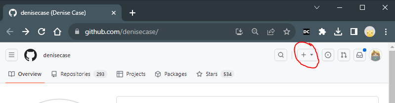

# 🟠 Start in GitHub to Create a New Repository

Now, create your own GitHub repository for your new project.

There are two ways to start:

1. **Copy a Template (Recommended)** - Create your own GitHub repository from the example, this time with a different name.
2. **Start From Scratch** - Create a new repository and build the project yourself.

Choose one option.

## Option 1. Create Your Custom Repository from the Template (Recommended)

This option is fast and easy.

A GitHub template creates a new repository under your GitHub account
with the example project's files and folders, but with a fresh Git history.

You should be logged into your GitHub account and viewing
the **original example project repository**.

1. Click **Use this template** (near the green **Code** button).
2. Select **Create a new repository**.
3. Choose your GitHub account as the **Owner**.
4. **IMPORTANT: Add a project-specific postfix to the example repository name,
   as directed in the example project.**
5. Select **Public**.
6. Click **Create repository**.

For example:

- Original: `denisecase/datafun-01-foundations`
- Your new project: `YOUR-USERNAME/datafun-01-foundations-housing`

You now have your own GitHub repository containing the example project.

You do not need to rename the internal Python source folders or files.
You will review the important parts of each file and make appropriate changes
as you work through the project.

## Option 2. Create Your Custom Repository in GitHub From Scratch

You may create a new repository and build the project yourself.

This option requires more experience and additional work.

The following guide explains the important parts of the project files,
but does not provide complete instructions for building every component from scratch.

1. Log in to your GitHub account.
2. In the top-right corner, click the **+** dropdown menu.
3. Select **New repository**.
4. Choose your GitHub account as the **Owner**.
5. Enter a name for your new repository.
   - Use all lowercase letters.
   - Use dashes between words.
   - Do not use spaces or special characters.
   - Follow the naming guidance provided in the example project.
6. Provide a brief description of your project (optional but recommended).
7. Select **Public**.
8. **IMPORTANT: Add a Default README File.**
   - Check the box for **Add a README file**.
9. Click **Create repository**.

You now have your own GitHub repository, ready for development.

## Verification

- [ ] I created a new custom repository under my GitHub account.
- [ ] My repository has a project-specific name, different from the example.
- [ ] My repository contains a README.md file.
- [ ] I can provide a clickable link to my new custom GitHub repository.

---

[◄ Back to 🟠 Workflow C](index.md)
